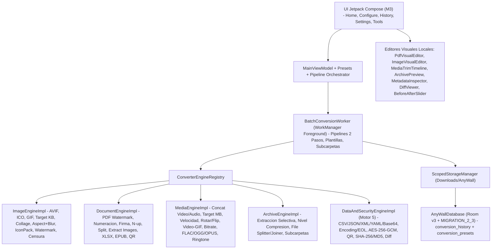

# Instrucción Maestra para Argon — AnyWall: Universal Converter v0.3

> **De:** Neon (Arquitectura y Planificación)  
> **Para:** Argon (Implementación, Pruebas y Release)  
> **Proyecto:** `AnyWall: Universal Converter` (`com.anywall.converter`)  
> **Autor / Desarrollador:** **SynthesizerEnd** (`https://github.com/ArukuSynthesis/AnyWall`)  
> **Objetivo:** Evolucionar el repositorio desde `v0.2` (`versionCode = 2`) hasta **`v0.3` (`versionCode = 3`, `versionName = "0.3"`)** integrando de forma modular, limpia y verificable el paquete completo de capacidades offline avanzadas.

---

## 0. Reglas Inquebrantables (Validar en Cada Fase)

1. **ESTRICTAMENTE 100% OFFLINE (0 permisos de red):**
   - Prohibido añadir `INTERNET` o permitir `ACCESS_NETWORK_STATE` en `app/src/main/AndroidManifest.xml` (conservar `<uses-permission android:name="android.permission.ACCESS_NETWORK_STATE" tools:node="remove" />`).
   - En `WebViewPdfGenerator`, mantener bloqueada toda petición de red (`blockNetworkLoads = true`, `blockNetworkImage = true`).
   - Al final de la implementación, `aapt2 dump permissions` sobre el APK release debe devolver **0 permisos de red**.
2. **CERO PLACEHOLDERS O STUBS:**
   - Prohibido dejar `// TODO`, funciones vacías o flujos simulados (`grep -rn "TODO" app/src/` debe devolver `0` resultados).
3. **ARQUITECTURA LIMPIA SIN HILT/DAGGER:**
   - Mantener inyección manual en [`AppContainer.kt`](file:///home/antigravity/ArukuSynthesis/AnyWall/app/src/main/java/com/anywall/converter/core/AppContainer.kt) y KSP exclusivamente para `androidx.room:room-compiler`.
   - Mantener [`FileConverterEngine`](file:///home/antigravity/ArukuSynthesis/AnyWall/app/src/main/java/com/anywall/converter/domain/engine/FileConverterEngine.kt) como contrato común y enrutar desde [`ConverterEngineRegistry`](file:///home/antigravity/ArukuSynthesis/AnyWall/app/src/main/java/com/anywall/converter/domain/engine/ConverterEngineRegistry.kt).
4. **SERIALIZACIÓN DETERMINISTA APTA PARA JUNIT EN JVM:**
   - Ningún modelo de dominio o serializador (`PdfPageEditSpec`, `ImageEditSpec`, `PipelineStep`, `ConversionPreset`, etc.) debe depender de `org.json.*` (que está stubbeado en `android.jar` durante `testReleaseUnitTest`). Usar serializadores puros en Kotlin probados con JUnit.
5. **ATRIBUCIÓN LEGAL Y CRÉDITOS AL DÍA:**
   - Mantener la autoría de **SynthesizerEnd** y actualizar [`AboutCreditsDialog.kt`](file:///home/antigravity/ArukuSynthesis/AnyWall/app/src/main/java/com/anywall/converter/ui/components/AboutCreditsDialog.kt) y [`THIRD_PARTY_NOTICES.md`](file:///home/antigravity/ArukuSynthesis/AnyWall/THIRD_PARTY_NOTICES.md) con cualquier librería nueva que se agregue (solo identificadores SPDX y enlaces de repositorio).
6. **ESTRATEGIA ZERO-BLOAT (DEPENDENCIAS MÍNIMAS):**
   - Implementar en **Kotlin puro / APIs nativas de Android** todo lo posible (`AES-256-GCM`, `SHA-256/MD5`, `CSV/JSON/XML/YAML/Base64`, `XLSX`, `EPUB`, `ICO`, `GIF` encoder, `File Splitter`, `Diff`, `Collage`, `ExifInterface`/`MediaMetadataRetriever`).
   - Dependencias nuevas **estrictamente opcionales y acotadas** permitidas para v0.3:
     - `com.google.zxing:core:3.5.3` (`Apache-2.0`, ~540 KB, 0 red) → Generador y lector offline de códigos QR/barras.
     - `androidx.exifinterface:exifinterface:1.3.7` (`Apache-2.0`, ~70 KB) → Inspección y limpieza forense completa de metadatos EXIF/GPS/IPTC.
     - `androidx.biometric:biometric:1.1.0` (`Apache-2.0`, ~120 KB) → Bloqueo biométrico opcional del Historial.
     - *(OCR offline)* **NO añadir modelos ML pesados** salvo confirmación explícita del usuario para evitar inflar el APK en +5 MB; dejar la decisión documentada al final.

---

## 1. Mapa Arquitectónico de AnyWall v0.3



---

## 2. Plan de Ejecución por Fases para Argon

> **Regla de ejecución para Argon:** Completar cada fase en orden, compilar y correr `./gradlew testReleaseUnitTest` al cierre de cada fase crítica antes de pasar a la siguiente.

---

### FASE 1 — Base de Datos v3, Preferencias, Presets, Renombrado, Subcarpetas y Bilingüe (`ES`/`EN`)

**Objetivo:** Preparar la infraestructura transversal de v0.3 sin romper compatibilidad con usuarios de v0.1/v0.2.

1. **Versión y Dependencias ([`gradle/libs.versions.toml`](file:///home/antigravity/ArukuSynthesis/AnyWall/gradle/libs.versions.toml), [`app/build.gradle.kts`](file:///home/antigravity/ArukuSynthesis/AnyWall/app/build.gradle.kts)):**
   - Subir `versionCode = 3`, `versionName = "0.3"`.
   - Añadir únicamente `androidx-exifinterface`, `androidx-biometric` y `zxing-core`.
2. **Room v3 + `MIGRATION_2_3` ([`AnyWallDatabase.kt`](file:///home/antigravity/ArukuSynthesis/AnyWall/app/src/main/java/com/anywall/converter/data/local/AnyWallDatabase.kt)):**
   - Crear entidad `ConversionPresetEntity` (`conversion_presets`: `id`, `name`, `description`, `categoryName`, `targetFormatName`, `optionsSerialized`, `isBuiltIn`, `createdAtEpochMillis`), `ConversionPresetDao` y `ConversionPresetRepository`.
   - Implementar `MIGRATION_2_3` creando la tabla `conversion_presets` sin tocar `conversion_history` y exportar esquema `app/schemas/.../3.json`.
   - Pre-sembrar presets útiles integrados en el primer arranque (ej.: *«WhatsApp Ligero (WEBP 75%, 1280px, sin EXIF)»*, *«Documento Oficial (PDF A4 + Numeración)»*, *«Audio Podcast (MP3 192 kbps)»*, *«Video Compacto 720p»*, *«Empaquetado Máximo TAR.XZ»*).
3. **Preferencias Locales ([`AppPreferences.kt`](file:///home/antigravity/ArukuSynthesis/AnyWall/app/src/main/java/com/anywall/converter/core/AppPreferences.kt)):**
   - Añadir:
     - `appLanguage`: `SYSTEM` / `ES` / `EN`.
     - `outputSubfolderMode`: `FLAT` (`Downloads/AnyWall/`), `BY_CATEGORY` (`Downloads/AnyWall/Imagenes`, etc.), `PRESERVE_TREE` (conservar estructura de subcarpetas al usar `OpenDocumentTree`) o `CUSTOM` (subcarpeta definida por el usuario).
     - `biometricHistoryLockEnabled`: `Boolean` (desactivado por defecto).
4. **Plantillas de Renombrado Dinámico y Encadenamiento (Pipelines de 2 pasos):**
   - Extender [`ConversionOptions.kt`](file:///home/antigravity/ArukuSynthesis/AnyWall/app/src/main/java/com/anywall/converter/domain/model/ConversionOptions.kt) con un `OutputNamingTemplateResolver` puro en Kotlin que interprete `{nombre}`, `{indice}`, `{fecha}`, `{formato}` (ej. `Factura_{indice}_{fecha}`).
   - Añadir `secondaryPipelineAction` opcional en `ConversionOptions` + [`BatchConversionWorker.kt`](file:///home/antigravity/ArukuSynthesis/AnyWall/app/src/main/java/com/anywall/converter/workers/BatchConversionWorker.kt) para encadenar un paso 2 sobre las salidas temporales del paso 1 antes de guardar en `Downloads/AnyWall/`:
     - `NONE`
     - `PACK_ZIP` / `PACK_TAR_XZ` (ej. Fotos → PDF → ZIP)
     - `ENCRYPT_AES256` (ej. Documentos → PDF → Cifrar AES-256)
     - `COMPUTE_SHA256_MANIFEST` (adjuntar archivo `.sha256.txt` verificable)
5. **Soporte Bilingüe (`ES` / `EN`):**
   - Extraer las cadenas de UI clave a `app/src/main/res/values/strings.xml` (español por defecto) y `app/src/main/res/values-en/strings.xml` (inglés), aplicando el idioma elegido en [`MainActivity.kt`](file:///home/antigravity/ArukuSynthesis/AnyWall/app/src/main/java/com/anywall/converter/MainActivity.kt) mediante `AppCompatDelegate` o contexto localizado en Compose.
6. **Escaneo Rápido desde Cámara + App Shortcuts + Quick Settings Tile:**
   - Añadir botón **«Cámara / Escáner»** en [`HomeScreen.kt`](file:///home/antigravity/ArukuSynthesis/AnyWall/app/src/main/java/com/anywall/converter/ui/screens/HomeScreen.kt) y [`ConfigureScreen.kt`](file:///home/antigravity/ArukuSynthesis/AnyWall/app/src/main/java/com/anywall/converter/ui/screens/ConfigureScreen.kt) usando `ActivityResultContracts.TakePicture` + `FileProvider` temporal (sin requerir permiso `CAMERA` explícito cuando se delega a la app de cámara del sistema).
   - Declarar accesos directos estáticos en `res/xml/shortcuts.xml` (*Unir PDF*, *Comprimir Imágenes*, *Extraer Audio*, *Bóveda/Herramientas*) manejados vía `Intent` extras en [`MainActivity.kt`](file:///home/antigravity/ArukuSynthesis/AnyWall/app/src/main/java/com/anywall/converter/MainActivity.kt).
   - Crear `AnyWallQuickTileService` (`android.service.quicksettings.TileService`) en el manifiesto para abrir AnyWall directo desde el Panel Rápido de Android.
7. **Preservación de Subcarpetas (`OpenDocumentTree`):**
   - Extender [`InputFileItem.kt`](file:///home/antigravity/ArukuSynthesis/AnyWall/app/src/main/java/com/anywall/converter/domain/model/InputFileItem.kt) con `relativeFolderPath: String = ""` poblado en [`UriFileResolver.resolveFolderTreeUris`](file:///home/antigravity/ArukuSynthesis/AnyWall/app/src/main/java/com/anywall/converter/core/UriFileResolver.kt) para replicar subcarpetas en [`ScopedStorageManager.kt`](file:///home/antigravity/ArukuSynthesis/AnyWall/app/src/main/java/com/anywall/converter/core/ScopedStorageManager.kt) y en [`ArchiveEngineImpl.kt`](file:///home/antigravity/ArukuSynthesis/AnyWall/app/src/main/java/com/anywall/converter/data/engines/ArchiveEngineImpl.kt).

---

### FASE 2 — Motor 1: Imágenes Avanzado + Editor Visual (`ImageVisualEditorDialog`) + Collages + IconPack + Antes/Después

**Objetivo:** Dar a las imágenes el mismo nivel interactivo que logró el editor visual de PDF en v0.2.

1. **Nuevos Formatos en [`SupportedFormat.kt`](file:///home/antigravity/ArukuSynthesis/AnyWall/app/src/main/java/com/anywall/converter/domain/model/SupportedFormat.kt) y [`ImageEngineImpl.kt`](file:///home/antigravity/ArukuSynthesis/AnyWall/app/src/main/java/com/anywall/converter/data/engines/ImageEngineImpl.kt):**
   - Entrada **`AVIF`** (detección por extensión, MIME `image/avif` y magic bytes `ftypavif`, decodificación nativa vía `ImageDecoder` en Android 12+).
   - Salida **`.ICO`** (codificador nativo puro en Kotlin de contenedor ICO con PNG embebido `256x256` / multi-resolución).
   - Salida **`GIF` animado** desde un lote de imágenes (codificador GIF89a / LZW puro en Kotlin con FPS / retraso por fotograma configurable).
   - Modo **Paquete de Íconos (`ICON_PACK_ZIP`)**: desde `SVG` o `PNG`, generar un `.zip` con `48px`, `96px`, `192px`, `512px` + `favicon.ico`.
2. **Modelo `ImageEditSpec.kt` + `ImageVisualEditorDialog.kt`:**
   - **Recorte interactivo (Crop)** sobre el lienzo con selector de relación de aspecto (`Libre`, `1:1`, `4:3`, `16:9`, `A4`).
   - **Volteo (Flip Horizontal / Vertical)** y rotación.
   - **Filtros rápidos locales (`ColorMatrix`):** `Original`, `Escala de grises`, `Documento Escaneado B/N Alto Contraste` (umbralización adaptativa / mejora de contraste y reducción de sombras), `Invertir`.
   - **Censura / Pixelado interactivo:** Permitir trazar rectángulos de censura (negro sólido o pixelado en bloques) en coordenadas normalizadas `[0..1]` sobre la vista previa; aplicados directamente sobre el `Bitmap` al exportar.
   - **Marca de agua de texto:** Texto configurable, posición (`Centro`, `Esquina inf. der.`, `Mosaico diagonal`), opacidad y tamaño.
   - **Ajuste de aspecto con fondo relleno/blur (`1:1`, `4:5`, `16:9`):** Envolver la imagen en lienzo objetivo con fondo difuminado (algoritmo *StackBlur* rápido en Kotlin) o color sólido.
3. **Compresión por Peso Objetivo (`targetMaxSizeKb: Int?`):**
   - Búsqueda binaria local sobre `quality` (y escalado suave si `quality = 15` aún excede el límite) para garantizar salidas `JPG`/`WEBP` menores al peso pedido (ej. `< 500 KB`).
4. **Creador de Collages y Tiras (Stitching):**
   - Cuando hay ≥ 2 imágenes seleccionadas, ofrecer modo **`COLLAGE_GRID`** (2×1, 2×2, 3×2, 3×3) y **`STITCH_VERTICAL` / `STITCH_HORIZONTAL`** (pegar capturas largas en una sola imagen `JPG`/`PNG` o `PDF`).
5. **Comparador Visual «Antes / Después» (`BeforeAfterSliderDialog.kt`):**
   - Accesible desde `HistoryItemCard` / resultado de conversión de imagen para deslizar una cortina interactiva comparando el archivo original (si sigue accesible) contra el optimizado, mostrando pesos y ahorro exacto.

---

### FASE 3 — Motor 2: PDF Profesional, Firma Manuscrita, Censura, `XLSX` y `EPUB`

**Objetivo:** Convertir [`DocumentEngineImpl.kt`](file:///home/antigravity/ArukuSynthesis/AnyWall/app/src/main/java/com/anywall/converter/data/engines/DocumentEngineImpl.kt) y [`PdfVisualEditorDialog.kt`](file:///home/antigravity/ArukuSynthesis/AnyWall/app/src/main/java/com/anywall/converter/ui/components/PdfVisualEditorDialog.kt) en una suite documental completa.

1. **Mejoras en `PdfVisualEditorDialog.kt` y `PdfPageEditSpec.kt`:**
   - **Duplicar página** e **Insertar página en blanco / separador** en cualquier posición.
   - **Panel de metadatos del PDF** (autor, título, creador, páginas, cifrado) con botón de limpieza de metadatos.
   - **Firma manuscrita local (`SignaturePadDialog.kt`):** Lienzo Compose con `Path` táctil (trazo suave + color negro/azul + botón guardar firma en almacenamiento privado de la app para reusar), posicionable sobre cualquier página seleccionada en el visor PDF y estampada como imagen PNG transparente vía `PDImageXObject`.
   - **Censura visual sobre páginas PDF:** Rectángulos de redacción opacos en coordenadas normalizadas estampados sobre el `PDPageContentStream` de las páginas elegidas.
2. **Nuevos Modos de Acción PDF (`PdfActionMode.kt` + `DocumentEngineImpl.kt`):**
   - **Marca de agua de texto diagonal** (`pdfWatermarkText`) con opacidad controlada (`PDExtendedGraphicsState`).
   - **Numeración automática de páginas** (`addPdfPageNumbers`, pie `"Página X de Y"`).
   - **División automática:** `SPLIT_EVERY_PAGE` (1 PDF por página) y `SPLIT_BY_CHUNK` (cada *N* páginas).
   - **Extractor de imágenes embebidas (`EXTRACT_EMBEDDED_IMAGES`):** Recorrer `page.resources.xObjectNames` en `PDFBox` y extraer los `PDImageXObject` originales en `PNG`/`JPG` sin rasterizar la página completa.
   - **Modo Folleto / N-up (`N_UP_2`, `N_UP_4`):** Agrupar 2 o 4 páginas por hoja A4/Carta usando `LayerUtility` / `PDFormXObject` de `PDFBox`.
   - **Estampado opcional de código QR** en esquina de la página 1 o todas las páginas (reutilizando el generador QR de la Fase 5).
3. **Soporte Ligero de `XLSX` y `EPUB` en Kotlin Puro (0 librerías pesadas):**
   - **`XLSX` (entrada) → `CSV` / `HTML` / `PDF`:** Parser `XlsxPureParser.kt` usando `ZipInputStream` + `XmlPullParser` (`xl/sharedStrings.xml`, `xl/workbook.xml`, `xl/worksheets/sheet*.xml`) convirtiendo cada hoja a tabla limpia.
   - **`EPUB` (entrada/salida):**
     - `EPUB` → `PDF` / `HTML` / `TXT` leyendo `META-INF/container.xml`, `content.opf` (`spine` + `manifest`) y capítulos XHTML vía `ZipInputStream`.
     - `TXT` / `MD` / `HTML` → `EPUB` construyendo paquete EPUB 3 válido (`mimetype` sin compresión primero, `META-INF/container.xml`, `OEBPS/content.opf`, `nav.xhtml`, capítulos XHTML).

---

### FASE 4 — Motor 3: Audio y Video Avanzado (Aprovechando `media3-effect`)

**Objetivo:** Exprimir al máximo `androidx.media3` ya incluido en [`libs.versions.toml`](file:///home/antigravity/ArukuSynthesis/AnyWall/gradle/libs.versions.toml) sin añadir binarios nativos gigantes.

1. **Línea de Tiempo Visual de Recorte (`MediaTrimTimelineCard.kt`):**
   - Detectar duración real automáticamente con `MediaMetadataRetriever`.
   - Extraer 8–10 miniaturas equidistantes del video en `Dispatchers.IO` y mostrar un `RangeSlider` de Material 3 con etiquetas `mm:ss` en vivo.
   - Para audio, añadir botón de **vista previa reproducible** del tramo seleccionado usando `android.media.MediaPlayer` local con liberación limpia en `DisposableEffect`.
2. **Transformaciones de Video con `media3-effect` ([`MediaEngineImpl.kt`](file:///home/antigravity/ArukuSynthesis/AnyWall/app/src/main/java/com/anywall/converter/data/engines/MediaEngineImpl.kt)):**
   - **Velocidad de reproducción (`0.5x`, `0.75x`, `1.25x`, `1.5x`, `2.0x`):** `SpeedChangeEffect` / `SonicAudioProcessor`.
   - **Rotación (`90°`, `180°`, `270°`) y Volteo (`Horizontal` / `Vertical`) de video:** `ScaleAndRotateTransformation.Builder()`.
   - **Compresor inteligente por peso objetivo (`targetVideoMaxSizeMb: Int?`):** Calcular `targetBitrateBps = ((targetMb * 8 * 1024 * 1024 * 0.92) / durationSeconds) - audioBitrate`, configurar `VideoEncoderSettings.Builder().setBitrate(...)` en `DefaultEncoderFactory` y escalar resolución si el bitrate resultante es muy bajo.
3. **Unión (Concatenación) de Múltiples Videos o Audios (`mergeMediaSequence: Boolean`):**
   - Cuando hay ≥ 2 videos o ≥ 2 audios seleccionados, encadenar con `EditedMediaItemSequence` + `Composition.Builder` de `Media3 Transformer` para generar un único archivo continuo en el orden del lote.
4. **Video → GIF Animado y Extracción de Fotogramas (`JPG` / `PNG`):**
   - Extraer fotogramas con `MediaMetadataRetriever.getFrameAtTime` cada *N* segundos (o en el rango recortado) para exportar imágenes individuales o alimentar el codificador GIF89a de la Fase 2.
5. **Audio Avanzado (`FLAC`, `OGG`, `OPUS`, Bitrate y Ringtone + Fade):**
   - Añadir **`FLAC`**, **`OGG`** y **`OPUS`** en [`SupportedFormat.kt`](file:///home/antigravity/ArukuSynthesis/AnyWall/app/src/main/java/com/anywall/converter/domain/model/SupportedFormat.kt) como entradas decodificadas nativamente en [`PcmWavMp3AudioHelper.kt`](file:///home/antigravity/ArukuSynthesis/AnyWall/app/src/main/java/com/anywall/converter/data/engines/PcmWavMp3AudioHelper.kt) y `MediaEngineImpl`.
   - Selector de **bitrate de audio** (`128`, `192`, `320 kbps`) aplicado a `jump3r` (MP3) y `MediaCodec` (`AAC`/`M4A`).
   - **Modo Tono / Ringtone + Fade In / Fade Out:** Aplicar envolvente lineal/coseno sobre muestras PCM (`fadeInMs`, `fadeOutMs`) y opción de guardar en `Downloads/AnyWall/Ringtones/` (o `MediaStore.Audio.Media.IS_RINGTONE`).

---

### FASE 5 — Motor 4 (Comprimidos Avanzado) + Nuevo Motor 5 (`DataAndSecurityEngineImpl`)

**Objetivo:** Completar las utilidades de compresión selectiva, seguridad criptográfica, formatos estructurados y herramientas técnicas 100% offline.

1. **Mejoras en [`ArchiveEngineImpl.kt`](file:///home/antigravity/ArukuSynthesis/AnyWall/app/src/main/java/com/anywall/converter/data/engines/ArchiveEngineImpl.kt):**
   - **Explorador Previo (`ArchivePreviewDialog.kt`):** Listar todas las entradas (ruta, tamaño, si es carpeta) de `.zip`, `.tar`, `.tar.gz`, `.tar.xz`, `.tar.bz2` y `.7z` **antes** de extraer, con casillas de selección para extraer únicamente las rutas elegidas (`selectedArchiveEntries: Set<String>`).
   - **Nivel de compresión (`FAST`, `BALANCED`, `MAXIMUM`):** Configurado en `ZipArchiveOutputStream.setLevel()`, `GzipParameters.setCompressionLevel()`, `XZCompressorOutputStream(preset)` y `BZip2CompressorOutputStream(blockSize)`.
   - **Divisor y Reconstructor de Archivos Grandes (`FILE_SPLIT` / `FILE_JOIN`):**
     - Partir cualquier archivo en bloques de tamaño configurable (ej. `10 MB`, `25 MB`, `50 MB`, `100 MB`) generando `<archivo>.part001`, `<archivo>.part002`… + manifiesto `<archivo>.anywall-parts.txt` con el `SHA-256` original.
     - Al cargar múltiples `.partNNN`, detectar automáticamente la reconstrucción, unirlos byte por byte y verificar el `SHA-256` si se adjuntó manifiesto.
2. **Nuevo Motor 5: `DataAndSecurityEngineImpl.kt` (registrado en [`AppContainer.kt`](file:///home/antigravity/ArukuSynthesis/AnyWall/app/src/main/java/com/anywall/converter/core/AppContainer.kt) y [`ConverterEngineRegistry.kt`](file:///home/antigravity/ArukuSynthesis/AnyWall/app/src/main/java/com/anywall/converter/domain/engine/ConverterEngineRegistry.kt)):**
   - **Conversor de Datos y Configuración (`CSV` ↔ `JSON` ↔ `XML` ↔ `YAML` ↔ `BASE64` ↔ `HTML` / `PDF`):**
     - Añadir `CSV`, `JSON`, `XML`, `YAML`, `BASE64`, `ANYWALL_VAULT` (`.anywall`) en [`SupportedFormat.kt`](file:///home/antigravity/ArukuSynthesis/AnyWall/app/src/main/java/com/anywall/converter/domain/model/SupportedFormat.kt) bajo una nueva categoría `FormatCategory.DATA_TOOLS` (*«Datos y Seguridad»*).
     - Parsers y formateadores puros en Kotlin con opción **`Pretty Print`** / **`Minificar`** para `JSON`/`XML`/`HTML`.
     - Renderizado de tablas limpias hacia `HTML`/`PDF` desde `CSV` y `JSON` (arrays de objetos).
   - **Reparador de Codificación y Saltos de Línea:**
     - Convertir archivos de texto (`TXT`, `CSV`, `MD`, `JSON`, `XML`, `HTML`, `YAML`) entre **`UTF-8`**, **`ISO-8859-1`**, **`Windows-1252`** y **`UTF-16`**, y normalizar saltos de línea **`LF` (`\n`) ↔ `CRLF` (`\r\n`)**.
   - **Bóveda Universal `AES-256-GCM` (`ANYWALL_VAULT` `.anywall`):**
     - Formato binario documentado y autocontenido: cabecera mágica `AWV1` (4 bytes) + salt (16 bytes) + IV (12 bytes) + metadatos originales (nombre y extensión cifrados) + payload cifrado con `AES/GCM/NoPadding` y clave derivada vía `PBKDF2WithHmacSHA256` (120 000 iteraciones).
     - Cifra **cualquier** archivo o lote; al cargar un `.anywall` pide contraseña y restaura el archivo original con su nombre exacto y verificación de integridad GCM.
   - **Códigos QR Offline (`QrToolDialog.kt` + soporte en motores usando `zxing-core`):**
     - **Generar QR** desde texto/enlace/vCard/archivo corto → guardar como `PNG`, `SVG` (vector puro generado desde la `BitMatrix`) o `PDF`.
     - **Leer QR** desde cualquier imagen cargada y copiar o guardar el contenido decodificado en `TXT`.

---

### FASE 6 — Herramientas de Inspección, Privacidad Forense, Diff, Estadísticas y Biometría

**Objetivo:** Exponer las utilidades de auditoría y privacidad en la UI sin saturar la pantalla principal.

1. **Inspector y Limpiador Forense de Metadatos (`MetadataInspectorDialog.kt`):**
   - Botón de inspección rápida en `InputFileCard` y en una hoja de **«Herramientas Offline»** accesible desde [`HomeScreen.kt`](file:///home/antigravity/ArukuSynthesis/AnyWall/app/src/main/java/com/anywall/converter/ui/screens/HomeScreen.kt).
   - Muestra en secciones claras:
     - **Imágenes:** Etiquetas `ExifInterface` (GPS lat/lon, cámara, lente, fecha, software, orientación).
     - **PDF:** `PDDocumentInformation` (título, autor, creador, productor, fechas, cifrado).
     - **Multimedia:** `MediaMetadataRetriever` (códec, bitrate, resolución, duración, ubicación si existe).
     - **Integridad:** Cálculo instantáneo de **`SHA-256`** y **`MD5`** con campo para pegar un hash esperado y verificar coincidencia (`✓ Coincide` / `✗ No coincide`).
   - Acción directa **«Limpiar metadatos ahora»** sin cambiar el formato del archivo.
2. **Comparador Local de Diferencias (`LocalDiffDialog.kt`):**
   - Al seleccionar exactamente 2 archivos de texto/código (`TXT`, `MD`, `JSON`, `XML`, `CSV`, `YAML`, `HTML`) o 2 `PDF` (extrayendo su texto vía PDFBox), calcular diferencias línea por línea (algoritmo LCS puro en Kotlin) y mostrarlas resaltadas en verde (`+`) y rojo (`-`) con opción de exportar el reporte `.diff` / `.txt`.
3. **Estadísticas Locales de Ahorro y Bloqueo Biométrico en [`HistoryScreen.kt`](file:///home/antigravity/ArukuSynthesis/AnyWall/app/src/main/java/com/anywall/converter/ui/screens/HistoryScreen.kt):**
   - Tarjeta resumen superior en Historial: total de archivos convertidos localmente, espacio total ahorrado (`MB/GB`) y distribución por categoría.
   - Si el usuario activa **«Bloquear Historial con biometría/PIN»** en [`SettingsDialog.kt`](file:///home/antigravity/ArukuSynthesis/AnyWall/app/src/main/java/com/anywall/converter/ui/components/SettingsDialog.kt), solicitar `BiometricPrompt` (`BIOMETRIC_WEAK or DEVICE_CREDENTIAL`) antes de revelar el contenido de `HistoryScreen`.

---

### FASE 7 — Créditos, Pruebas Unitarias Exhaustivas, Documentación y Release v0.3

1. **Actualizar Créditos y Documentación:**
   - Actualizar [`AboutCreditsDialog.kt`](file:///home/antigravity/ArukuSynthesis/AnyWall/app/src/main/java/com/anywall/converter/ui/components/AboutCreditsDialog.kt) y [`THIRD_PARTY_NOTICES.md`](file:///home/antigravity/ArukuSynthesis/AnyWall/THIRD_PARTY_NOTICES.md) con `ZXing Core`, `AndroidX ExifInterface` y `AndroidX Biometric` (SPDX `Apache-2.0` + URLs oficiales), manteniendo a **SynthesizerEnd** como autor y creador.
   - Actualizar [`CONTEXT.md`](file:///home/antigravity/ArukuSynthesis/AnyWall/CONTEXT.md), [`README.md`](file:///home/antigravity/ArukuSynthesis/AnyWall/README.md) y [`.github/workflows/release.yml`](file:///home/antigravity/ArukuSynthesis/AnyWall/.github/workflows/release.yml) con las novedades y arquitectura de `v0.3`.
2. **Suite Ampliada de Pruebas Unitarias (`app/src/test/java/com/anywall/converter/`):**
   - Añadir pruebas deterministas en JVM para todos los algoritmos puros nuevos:
     - `OutputNamingTemplateResolver` (`{nombre}`, `{indice}`, `{fecha}`, `{formato}`).
     - `ImageEditSpec` y `PdfPageEditSpec` (serialización sin `org.json`).
     - `AesVaultCrypto` (cifrado/descifrado AES-256-GCM + fallo esperado con contraseña incorrecta).
     - `StructuredDataConverter` (`CSV ↔ JSON ↔ XML ↔ YAML ↔ Base64`, Pretty/Minify, UTF-8 ↔ ISO-8859-1, LF ↔ CRLF).
     - `XlsxPureParser` y `EpubPureConverter` (con archivos ZIP sintéticos generados en test).
     - `FileSplitterAndJoiner` (particionado, reconstrucción exacta y validación SHA-256).
     - `LineDiffEngine` (LCS líneas añadidas/eliminadas/iguales).
     - `GifEncoderPure` e `IcoEncoderPure` (verificación de cabeceras mágicas `GIF89a` y `00 00 01 00`).
     - `ConverterEngineRegistry` (enrutamiento de lotes mixtos, nuevos formatos y motor 5).
3. **Verificación Final Obligatoria:**
   ```bash
   ./gradlew assembleRelease testReleaseUnitTest --no-daemon --stacktrace
   aapt2 dump permissions app/build/outputs/apk/release/app-release.apk
   grep -rn "TODO" app/src/
   ```
   - Confirmar: **0 errores**, **0 advertencias críticas**, **100% tests en verde**, **0 permisos de red** (`INTERNET` / `ACCESS_NETWORK_STATE`) y **0 `TODO`**.

---

## 3. Prompt Directo de Arranque para Argon

Cuando quieras iniciar la ejecución, simplemente dile a Argon:

> **«Argon, ejecuta el plan completo de `PLAN_V0.3_ARGON.md` para construir AnyWall v0.3 respetando todas las reglas de `CONTEXT.md` (100% offline, 0 permisos de red, 0 TODOs, autor SynthesizerEnd). Avanza por fases de la Fase 1 a la Fase 7 compilando y verificando pruebas unitarias al finalizar cada bloque, y avísame cuando el APK release v0.3 esté verificado y listo para commit y release.»**
